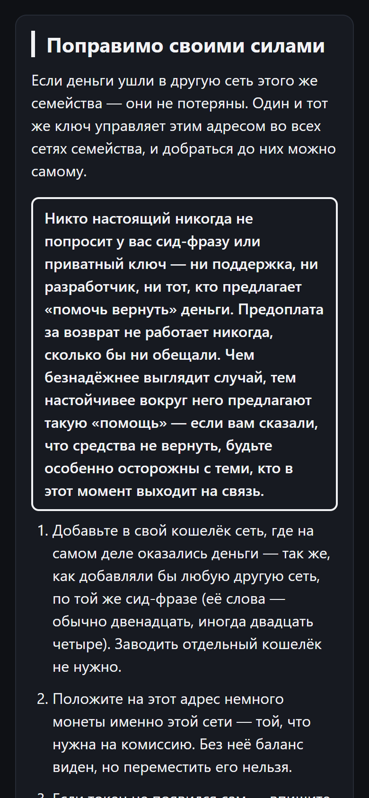

# Не та сеть

Страница для людей, которые отправили криптовалюту не в ту сеть. Она объясняет, что произошло и что в таком случае возможно, а что нет.

Вы вставляете адрес, на который отправляли, указываете сеть, по которой отправляли, и кто владеет адресом: ваш собственный кошелёк, чужой кошелёк или адрес пополнения на бирже. Страница даёт исход — от «отправка не могла состояться» до «скорее всего потеряно» — и шаги, которые подходят к вашему случаю. Возврат она не обещает. В части случаев ответ такой: «зависит от биржи» или «скорее всего, сделать ничего нельзя».

**Открыть:** https://vimakushin.github.io/wrong-network/

[English version of this file](README.md)



Снимок обрезан после первых шагов. Адрес на нём — публичный пример, он не принадлежит никому из тех, кто пользовался страницей.

**Состояние проекта: в работе.** Первая версия опубликована. На живых людях её ещё не пробовали, и несколько вещей остаются открытыми (см. «Что открыто»).

## Почему эта задача

Сервисы проверки адреса отвечают на один вопрос: верен ли формат. Они пишут «адрес корректен» и на этом заканчивают. Человек, только что отправивший средства не в ту сеть, спрашивает другое: пропали ли мои деньги?

Ответ зависит не от сети, а от того, кто владеет ключом на той стороне.

- Во многих сетях (Ethereum, BNB Smart Chain, Polygon и других) адреса устроены одинаково, и один приватный ключ управляет этим адресом во всех сетях такого рода. Если монеты ушли на ваш собственный кошелёк в такой сети, они, как правило, по-прежнему ваши: вы добавляете сеть в кошелёк и, положив немного основной монеты этой сети на комиссию, переносите их.
- Если они ушли на адрес пополнения биржи, ключ у биржи, и решение за ней.
- Если они ушли на адрес контракта, за которым нет ключа, они, скорее всего, потеряны.

Одна и та же ошибка бывает поправимой, а бывает такой, которую уже не исправить. Страница помогает понять, на какой из двух случаев это похоже.

## Чего страница не делает

- **Не обещает возврат.** Формулировки написаны так, чтобы не читаться как «мы вернём». Где исход неясен, страница так и пишет («зависит от биржи, гарантий нет»). Где деньги скорее всего потеряны, она говорит и это.
- **Не просит сид-фразу и приватный ключ.** Полей для них нет. Если в поле адреса вставить то, что похоже на сид-фразу (двенадцать слов и больше), страница сразу очищает поле и пишет, что фразу не приняла и никуда не отправила. Приватный ключ — это строка шестнадцатеричных цифр, и страница не пытается его узнавать.
- **Предупреждает о мошенниках в каждом ответе, каким бы ни был исход.** На потерявших крипту охотятся: «пришлите сид-фразу, я верну», «оплатите комиссию за разблокировку». Предупреждение говорит, что никто настоящий не попросит сид-фразу или приватный ключ и что предоплата за «возврат» не работает. Текст везде один и тот же, намеренно: если бы он зависел от исхода, один из вариантов могли бы оставить смягчённым или устаревшим.
- **Не направляет к фирмам по возврату.** Ссылок на фирмы, обещающие вернуть деньги, нет. Единственный внешний инструмент, который страница называет, — открытый инструмент восстановления самой BNB Chain, в случае остановленной сети BNB Beacon Chain. Он назван простым текстом, не кликабельной ссылкой.
- **Не смотрит в блокчейн.** Не проверяет баланс, не ищет транзакцию, не подключает кошельки.

## Оформление: ни один цвет не несёт смысла

Страница одна, тёмная, и ни один цвет на ней ничего не значит. Нет зелёного для «поправимо» и красного для «потеряно». Исход сообщается словами.

Причина — в читателе. Красная рамка вокруг «вернуть нельзя» тяжела для человека, который только что потерял деньги, и ничего не объясняет. Зелёная рамка вокруг «вернуть можно» — обещание, которое страница не может дать. Поэтому части ответа (заголовок, пометка, предупреждение) различаются размером, весом шрифта, линией и местом на странице. Каждый цвет в стилях — это фон, серый или цвет самого текста. Рассуждение записано в комментарии в начале [`style.css`](style.css).

## Устройство: ничего никуда не отправляется

Всё считается в вашем браузере. Своего сервера, который получал бы то, что вы вводите, у страницы нет. Адрес не отправляется, не сохраняется и не ищется ни в каком сервисе. (Сами файлы лежат на GitHub Pages, как у любого статического сайта.)

Это не только про приватность. У человека, только что потерявшего деньги, есть основания не доверять всему, что просит вставить его адрес.

- Во время работы страница не делает сетевых запросов. Content-Security-Policy в [`index.html`](index.html) велит браузеру их отклонять: скрипты и стили только с этого же сайта, любые другие соединения закрыты.
- Шрифты только системные: внешний шрифт был бы запросом к чужому серверу.
- Проверка адресов опирается на две библиотеки (`@noble/hashes`, `@scure/base`). Их файлы лежат в [`vendor/`](vendor/) без правок и не склеены в один, чтобы их можно было прочитать целиком. Версии и контрольные суммы — в [`vendor/README.md`](vendor/README.md). Подключение с CDN было бы сетевым запросом, а страница обещает их не делать.

## Что есть в первой версии

- Семейство адреса определяется по формату: EVM (`0x…`), Tron, Solana, Bitcoin, TON и семейство Cosmos (`cosmos1…`, `osmo1…`, `bnb1…`). В списке 16 сетей отправки.
- Исходы:
  - ошибка была невозможна (сеть не принимает адреса такого вида);
  - поправимо своими силами (свой кошелёк, другая сеть с тем же форматом адреса);
  - поправимо, но только другим человеком (чужой кошелёк);
  - зависит от биржи;
  - скорее всего потеряно;
  - остановленная сеть BNB Beacon Chain: восстановление может быть возможно через инструмент BNB Chain, гарантий нет.
- Ещё три ответа: ошибки в сети нет (адрес и сеть подходят друг другу, чинить нечего); адрес не узнан; в адресе похоже на опечатку.
- Шаги для поправимых случаев, а для биржи — что написать в обращении.
- Отдельные объяснения для известных опасных случаев: устаревшие адреса Bitcoin и Bitcoin Cash совпадают по формату, BNB Beacon Chain (BEP-2) и BNB Smart Chain (BEP-20), отдельные цепи Avalanche.
- Вёрстка рассчитана на телефон. Последний раз проверена 8 октября 2026 в браузере на компьютере на ширине 320, 360 и 390 пикселей, горизонтальной прокрутки нет.
- Есть автоматические тесты, запуск: `npm test`.

## Что открыто

- **Не пробовали на живых людях.** Пока неизвестно, помогают ли формулировки человеку, который только что совершил эту ошибку. Выяснить это можно только на живых людях.
- **Не проверено на настоящем телефоне.** Пока проверяли в браузере на компьютере на телефонных ширинах. Firefox и Android не проверяли.
- **Отправка на адрес контракта определяется только для короткого списка.** В списке три адреса контрактов токенов. Про любой другой адрес страница о контрактах не говорит ничего, и отсутствие адреса в списке не значит, что это кошелёк.
- **Формулировка «поправимо» условная.** В пояснении сказано «если деньги ушли в другую сеть этого же семейства» (сети с одним форматом адреса), потому что страница не знает, в какую сеть человек собирался отправить.
- **Английской версии страницы пока нет.**
- **Правил отдельных бирж нет.** Для адресов пополнения страница может сказать только, что исход зависит от биржи.
- **Сказанное про сети и биржи надо перепроверять.** Названия сетей, дата остановки BNB Beacon Chain и адрес инструмента восстановления BNB Chain проверены автором по источникам на момент написания. Заново их не проверяли. Инструмент чужой, поэтому проверять его надо перед каждой публикацией.

## Запуск

```
npm test
```

Чтобы открыть страницу у себя, отдайте папку любым статическим файловым сервером. `index.html` собирается командой `node scripts/build-page.js` из [`src/page.template.html`](src/page.template.html), [`src/texts.js`](src/texts.js) и списка сетей; правят их, а не готовый файл.
